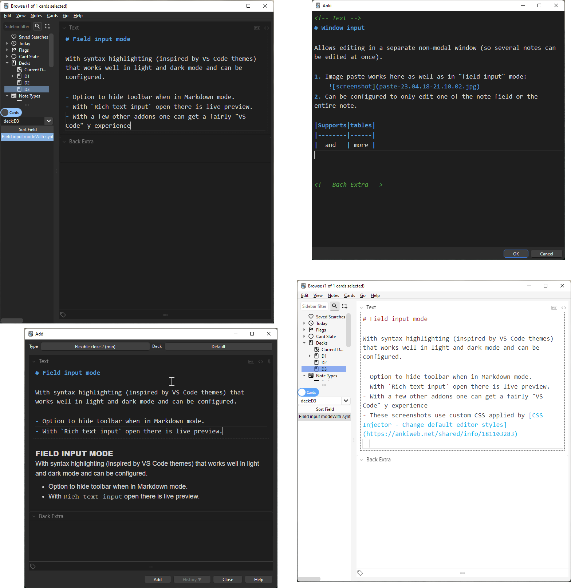
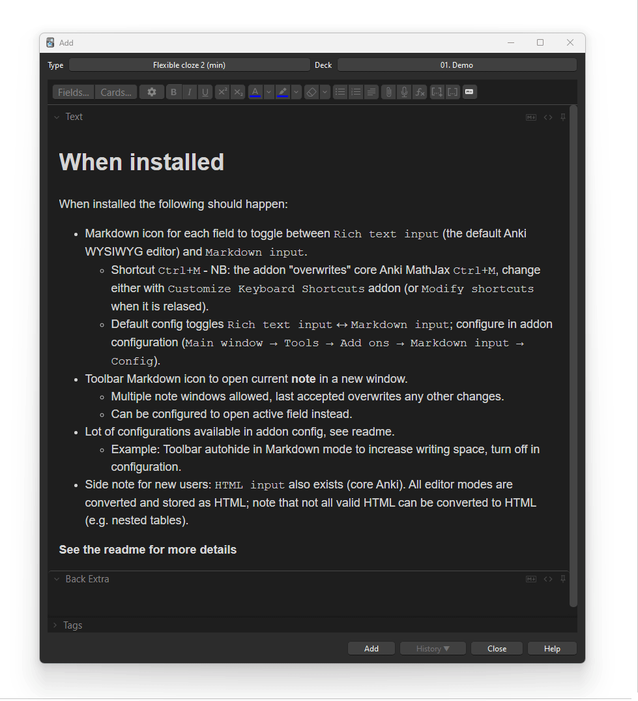

# Markdown input

Anki ([GitHub](https://github.com/ankitects/anki)) addon ([GitHub](https://github.com/TRIAEIOU/Markdown-input)) that allows adding and editing notes in extended [CommonMark](https://spec.commonmark.org/) [Markdown](https://daringfireball.net/projects/markdown/), either directly in the editor fields ("field input mode", similar to the core rich and plain text edit interface) or by opening a separate window to edit a specific field or the entire note ("window input mode").





## Anki version note (2.1.56+)

The editor DOM and internal functioning which `Markdown input` depends on changed in Anki version 2.1.56. The current version of `Markdown input` only supports 2.1.56+, the last [release](https://github.com/TRIAEIOU/Markdown-input/releases/tag/v1.2.5) targeted at 2.1.55 is available as a separate branch but no further updates or bug fixes will be made in that branch.

## Warning

- Markdown is not "another way to write HTML", it is a plain text format that has a determined translation to HTML (the format the Anki editor uses). The HTML generated is a subset of all HTML and, amongst other things, makes heavy use of `<p>` tags (which are not used by the Anki editor). Furthermore there is no spec on the conversion from HTML *to* Markdown. This makes conversion tricky and there is risk for loss of information when cycling HTML → Markdown → HTML.
- Editing a field in Markdown will result in the original field HTML being converted to Markdown and then back to HTML - the end result may differ from the original (especially in case of complex HTML). For instance, the representation of tables does not allow for nested tables in Markdown. So if the original HTML has nested tables these will be lost on cycling. If you are not familiar with Markdown consider duplicating your deck and play around with a copy so that you are sure you know what you are doing.
- Note however, that if you do not make any changes in the "field input mode" or cancel the "window input mode" the orginal Anki HTML will remain untouched when you toggle back. Also note that in field input mode making a change and then undoing will still count as "making a change" (changes update the HTML continuously).
- If you are not familiar with Markdown look it up where it [began](https://daringfireball.net/projects/markdown/basics) or [here](https://commonmark.org/help/tutorial/) or [here](https://commonmark.org/help/) for instance, to determine if it is for you.

## HTML ↔ Markdown

Conversion to/from HTML is done through [unified](https://unifiedjs.com/) Markdown functions `hast-util-from/to-html` `hast-util-to-mdast`/`mdast-util-to-hast` and `mdast-util-to/from-markdown` which are [CommonMark](https://spec.commonmark.org/) compliant. The following changes/extensions has been made in the addon:

- Markdown uses `<p>` tags to mark paragraphs, these are replaced with `<br>` tags instead to match the Anki editor.
- Markdown has a concept of lists being ["tight" or "loose"](https://spec.commonmark.org/0.30/#loose) which results in list items being wrapped in `<p>` tags or not. This has been replaced with HTML `.markdown-tight` or `.markdown-loose` classes to allow styling, example:

  ``` CSS
  ul.markdown-loose > li, ol.markdown-loose > li {padding-top: 10px; padding-bottom: 10px;}
  ul.markdown-tight > li, ol.markdown-tight > li {padding: 0px}
  ```

- Spec `<em>sample</em>` (`*sample*`) and `<strong>sample</strong>` (`**sample**`) are swapped to `<i>` and `<b>` to match the Anki editor.
- Markdown syntax extensions (set to `true` or `"some vale"` to enable, `false` to disable):
  - `Subscript`: `true` for `~sample~` subscript
  - `Superscript`: `true`for `^sample^` superscript
  - `Underline`: `true` for `_sample_` underline (spec Markdown is `<em>`, disable to revert to spec).
  - `Strikethrough`: `"double"` for `~~sample~~` strikthrough (`"single"` supports single tilde, incompatible with subscript above).
  - `Inline media`: `true`for [Inline Media](https://ankiweb.net/shared/info/683715045) directive, e.g. `:audio(im-xyz.ogg){loop auto_front}`/`:video(im-xyz.ogg){loop auto_front height=200}`.
  - `Definition lists`: `true` for [Defintion lists](https://github.com/wataru-chocola/mdast-util-definition-list) (not available in the core Anki editor).
  - `Table stle`: Table syntax, `"gfm"`/`"extended"`:
    - GFM table syntax

    ``` Markdown
    | A     |   GFM |
    | :---- | ----: |
    | table |     ! |
    ```

    - Extended table syntax - GFM style extended to allow headerless tables (no `<thead>` generated):

    ``` Markdown
    | :--: | ----: |
    |  A   | table |
    | with |  rows |
    ```

    - `Table newline`: Symbol to replace hard line break (`<br>`) inside table cells (newline characters are normally not allowed inside Markdown table cells)
    - `fences`: Optional [fencing pipes](https://github.github.com/gfm/#tables-extension-) (i.e. at start and end of each row).
    - Align none, left, right and center as per [GFM format](https://github.github.com/gfm/#tables-extension-).

## Editor

The editor used is [CodeMirror 6](https://codemirror.net/) with the following configurations:

- Markdown syntax highlighting and auto fill (continue lists, autoindent etc.).
- Undo history.
- Multiple drawable selections.
- Search and replace with configurable default options (`caseSensitive`, `regexp`, `wholeWord`).
- Insert cloze deletions as well as a few different functions to manipulate clozes (see below).
- Customize Markdown input editor shortcuts (i.e. *inside* the field/window, not the core Anki editor) in `config.json`, see `config.json` and [CodeMirror documentation](https://codemirror.net/docs/ref/#view.KeyBinding) for further information.
  - Note that the default Anki shortcuts "eats" some of these before they ever reach the editor so either set to other key sequebces in config or unmap/remap the Anki editor shortcuts with [Override shortcuts](https://ankiweb.net/shared/info/604635542), [Customize Keyboard Shortcuts](https://ankiweb.net/shared/info/24411424) or similar.
  - The format of `CodeMirror` shortcuts are `CodeMirror`-style, modifiers and keys separated by `-` rather than `+` and `Mod` corresponds to `Ctrl` on Windows and `Meta` on MacOS.
  - Also note that `Ctrl-Alt` results in the char being interpreted as upper case, amend the sequence appropriately, i.e. `Ctrl-Alt-x` never fires, only `Ctrl-Alt-X`.
- Customize the editor styling by copying `cm.css` into `user_files` subdirectory and customize. Consider using `--var(xyz)` to use the Anki colors from the current theme (i.e. follows light/dark mode).

### Editor commands

Available editor commands are most standard CodeMirror commands (see [@codemirror/commands](https://github.com/codemirror/commands/blob/main/src/commands.ts), [@codemirror/search](https://github.com/codemirror/search/blob/main/src/search.ts)), for instance `openSearchPanel` (default `Ctrl-f`), `findNext` (default `Ctrl-n`), `selectNextOccurence` (default: `Ctrl-d`), `selectSelectionMatches` (default `Ctrl-Shift-l`) and `gotoLine` (default `Ctrl-g`). Additionally the following custom functions are available:
- `help`: Display short help dialog, lists all mapped `Markdown input` shortcuts (default `Ctrl-h`).
- `joinLines`: Join all lines in selection(s), or next line when no selection is made, with a space between each (default `Ctrl-Shift-j`).
- `clozeNext`: Cloze selection(s) incrementing cloze ordinal for each (default `Ctrl-Shift-c`).
- `clozeCurrent`: Cloze selection(s) without increment (default `Ctrl-Alt-C`/`Ctrl-Alt-Shift-C`).
- `autoCloze`: In selection(s), or the entire document if no selection is made, insert incrementing clozes around text following any colon (default `Ctrl-Shift-a`) according to the following logic:
    - In a paragraph cloze until hard line break (double space before newline or backslash newline) or end of paragraph.
      - If clozing to end of paragraph and the paragraph is followed by a list, also include the list in the cloze.
    - In a list item cloze until end of list item.
      - If the next item is a nested list also include this in the cloze.
    - In a table cell encloze until the end of the table cell.
      - Special case, if the cell starts with a `:` the entire cell will be enclozed (and the `:` removed)
    - `:` in all other places will be disregarded (e.g. in headings, table header row etc.) as will all non-singel (`::`) or escaped (`\:`) colons. NB: `::` is the start of a hint within a cloze, therefore using `::` for "colons that shouldn't be clozed" may not give the results you expect.
    - No cloze will be inserted if there already is a cloze at that location.
- `unclozeSelections`: Remove all clozes within selection(s), or any cloze spanning the current cursor position if no selection is made, leaving the contents intact (default `Ctrl-Shift-u`).
- `sortCloze`: Restructure cloze ordinals in ascending order, keeping groups of same cloze ordinal together. Note: this will mess upp the scheduling if you have started to learn the cards (default `Ctrl-s`).
- `syncClozes`: Restructure cloze ordinals within selection(s) so the all have the same ordinal as the first ordinal found (default `Ctrl-Shift-s`).
- `pasteMarkdown`/`pasteMarkdownAppend`/`pasteMarkdownStrip`: Convert any HTML in the clipboard to Markdown before pasting. `pasteMarkdownAppend` also amends any pasted clozes to come after any existing ordinals in the document. `pasteMarkdownStrip` also strips any cloze tags, but keeps the content, prior to pasting. (`pasteMarkdownAppend` default `Ctrl-v`, `pasteMarkdown` default `Ctrl-Shift-v`, `pasteMarkdownStrip` default `Alt-Shift-u`)
- `pasteText`/`pasteTextAppend`/`pasteTextStrip`: Similar to the equivalent `pasteMarkdown` but disregards uses the text version of the clipboard, trying to amend any lists to correct Markdown formating.
- `pasteRaw`: Pastes text content of clipboard without any modification (default `Alt-Shift-v`). 

### Field input mode

- Configurable default state for editor fields (`rich text`, `markdown` or `rich text/markdown`, default `rich text`).
- Configurable behaviour of "field input mode" shortcut, cycle between rich text and Markdown (`true`) or just toggle Markdown input (`false`). (default `true`)
- Configurable shortcut to toggle rich text input. (default `Ctrl+Alt+X`)
- Configurable shortcuts to move to next/previous input (since tab is a valid Markdown character it will not work to "tab out" of a markdown input). (default `Ctrl+PgDown` and `Ctrl+PgUp`)
- Configurable option to autohide editor toolbar when focusing Markdown input (to increase available space). (default `true`)

### Window input mode

- Configurable window size (`parent`, `last` or `WidthxHeight`, default `parent`)
- Configurable note editing mode, either the entire note (i.e. all fields) or current field. In `note` editing mode the fields are separated by HTML comments (e.g. `<!-- Front -->`) and content will be inserted into the correspondingly named field. (`note` or `field`, default `note`)

## Configuration

- "Field input mode" can be configured under `Field input`, note that the default shortcut, `Ctrl+M` conflicts with Mathjax shortcuts, remap one of them.
- "Window input mode" can be configured under `Window input`.
- HTML ↔ Markdown conversion configurable under `Converter`. See [mdastToMarkdown](https://github.com/syntax-tree/mdast-util-to-markdown#tomarkdowntree-options) for `Markdown format` options.
- Editor configurable under `CodeMirror`. See [CodeMirror documentation](https://codemirror.net/docs/) how to configure.
- Default Anki behaviour is to use the entire sort field text in the Browser table, `Browser sort field` option (default `true`) instead uses content of first level 1 heading (if existing).
- To customize the look of the finished HTML apply custom [CSS](https://www.w3schools.com/Css/) styling (for instance of `<h1/2/3/etc>`, `<table>` `<ul/ol>` etc.) to the note template.
- To customize the look and feel of the editor, make a copy of `cm.css` (styling of CodeMirror and syntax highlighting) into a `user_files` subdirectory in the addon directory and modify that file (it will be given precedence and not be overwritten on addon update).

## Suggested companion addons

To achieve a note editing friendly interface consider using:

- [Override shortcuts](https://ankiweb.net/shared/info/604635542) or [Customize Keyboard Shortcut](https://ankiweb.net/shared/info/24411424) to unmap relevant shortcuts you want to use in CodeMirror.
- [CSS Injector - Change default editor styles](https://ankiweb.net/shared/info/181103283) to modify the editor interface for smaller margins, for instance something like this will give a slicker, VS Code inspired, editor interface:

  ```css
  /* editor.css */
    div > div.editor-field {
        border-radius: unset;
        border: none !important;
        box-shadow: none !important;
        padding-left: 10px;
        padding-right: 10px;
        padding-bottom: 5px;
    }
    div:not(:nth-child(1)) > .field-container {
        border-top: 1px solid var(--border);
    }

    .editor-toolbar .button-toolbar {
        border: none;
        padding: 7px 7px 0px 7px;
        margin: 0px;
    }

    .editor-field {
        --fg: #3b3b3b;
        --selected-bg: #ADD6FF80;
    }
    .night_mode .editor-field {
        --fg: #d4d4d4;
        --selected-bg: #ADD6FF26;
    }

    body {
        --fg: #3b3b3b;
        --canvas: #ffffff;
        --canvas-elevated: #ffffff;
        --border: #CECECE;
        --border-focus: 1px solid #3794ff;
    }
    body.night_mode {
        --fg: #858585;
        --canvas: #1e1e1e;
        --canvas-elevated: #1e1e1e;
        --border: #474747;
        --border-focus: 1px solid #3794ff;
    }
  ```

  and

  ```css
  /* field.css */
  anki-editable.night_mode {
    color: var(--fg);
    font-size: 18px;
  }
  ```

- [Sidebar table](https://ankiweb.net/shared/info/1753198255) to move the note/card table to the side for increased editing space, esp. with `Markdown input` `Autohide toolbar` set to `true`
- [Browser Maximize/Hide Table/Editor/Sidebar](https://ankiweb.net/shared/info/1819291495) to toggle hiding the sidebar with a keyboard shortcut (e.g. `Ctrl+Shift+B`)

## Developers

Functionality split into different classes to facilitate reuse:

- [anki-md-html](https://github.com/TRIAEIOU/anki-md-html): library which converts Anki style HTML ↔ Markdown.
- [CustomInputClass](https://github.com/TRIAEIOU/Markdown-input/blob/main/src/ts/custom_input.ts) encapsulates adding an editor to the `Note editor` fields.
- [Editor](https://github.com/TRIAEIOU/Markdown-input/blob/main/src/ts/editor.ts) encapsulates the CodeMirror editor.

## Changelog

- 2022-08-27: Add image paste support, prevent focus from being stolen on focus in/out, bug fixes.
- 2022-10-16: Make window mode non-modal (and allow multiple windows open), add `Ctrl-Shift-j` to join lines, make inline Markdown syntax configurable, make several options configurable, bug fixes.
- 2022-11-20: Make rich and plain text input editable while Markdown input is visible and adjust `config.json` appropriately, add buttons/badges, restructure configuration.
- 2022-12-13: Correct update `json.config` bug.
- 2022-12-16: Fix multiple badges bug.
- 2022-12-20: Fix field input mode bug for *nix (tested in VM `Ubuntu 22.04 LTS`) and macOS (tested in a really slow VM `High Sierra`).
- 2022-12-22: Badge rework and bug fix
- 2023-01-09: Move to 2.1.56 platform (last 2.1.55 shipped until further notice), fix syntax highlighting.
- 2023-03-11: Restructuring of code to allow modularity with other projects and easier maintenance.
- 2023-03-12: Change "dialog mode" to "window mode" and inherit QMainWindow rather than QDialog. Add option to edit complete note in window mode, improve CSS styling of editor, now done from separate CSS file. Modify default styling (based on VS Code styles) to suit both light and dark mode. Fix anyoing eating of trailing spaces when focusing to another window. Add option to hide editor toolbar when focusing a Markdown field.
- 2023-04-26: Improve logic to fix anoying eating of trailing spaces, change search/replace dialog placement so that it is visible without having to scroll.
- 2023-05-04: Add `rich text/markdown` field default configuration option, add list continuation thanks to [David C.](https://github.com/d-k-bo).
- 2023-06-01: Table bug fix (tables now non-optional), rename config option from `Table style` to `Tables`, add code block syntax highlighting, add `Browser sort field` option, add styling of cloze tags in the Markdown editor.
- 2023-08-26: Add paste HTML (including clean up of HTML from Word) as Markdown or text, optionally amending or stripping clozes, "uncloze", "auto cloze", "sync clozes" and "help" functionality added. Added Markdown conversion options `tightenLists` (removes blank line before a "tight" list) and `listItemIndentLeadOnly` (when used with `listItemIndent`:`"tab"` aligns nested lists at multiples of 4 spaces but only one space *after* the bullet).